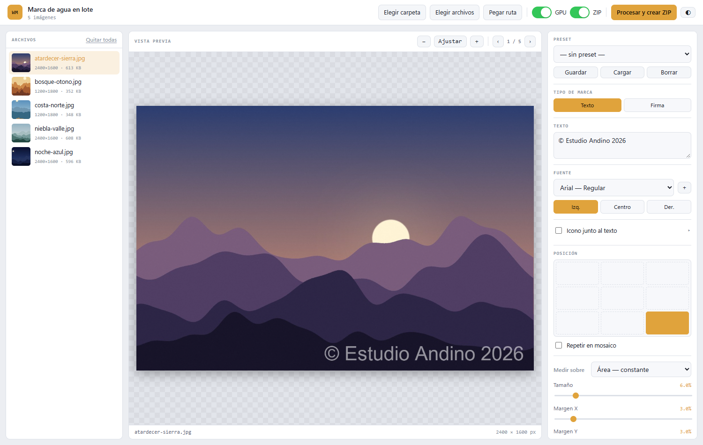
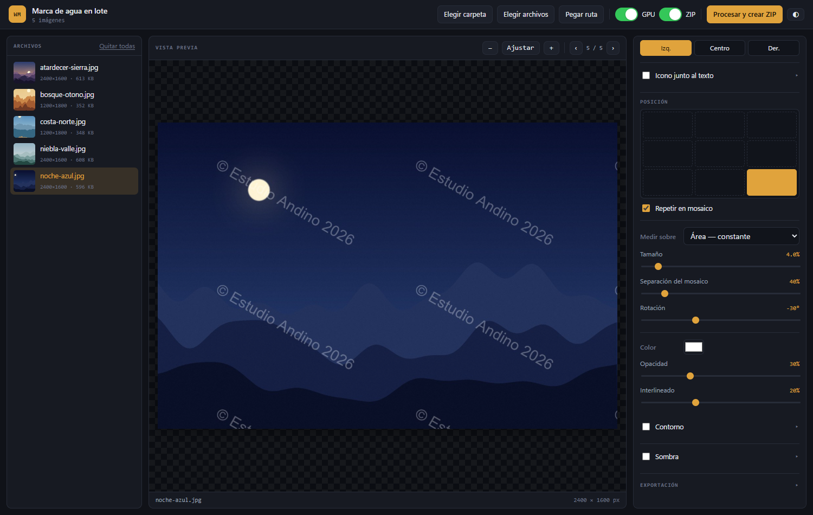
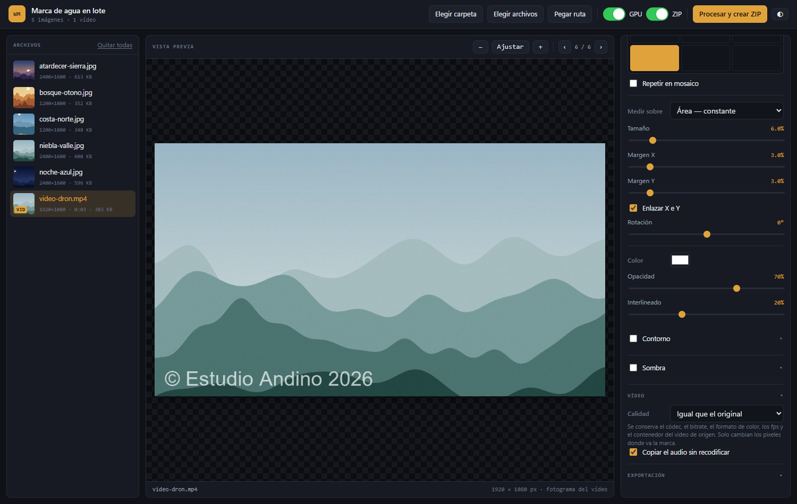
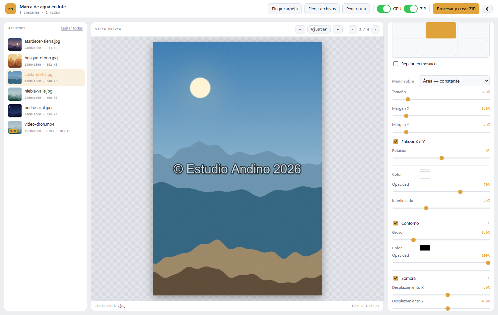
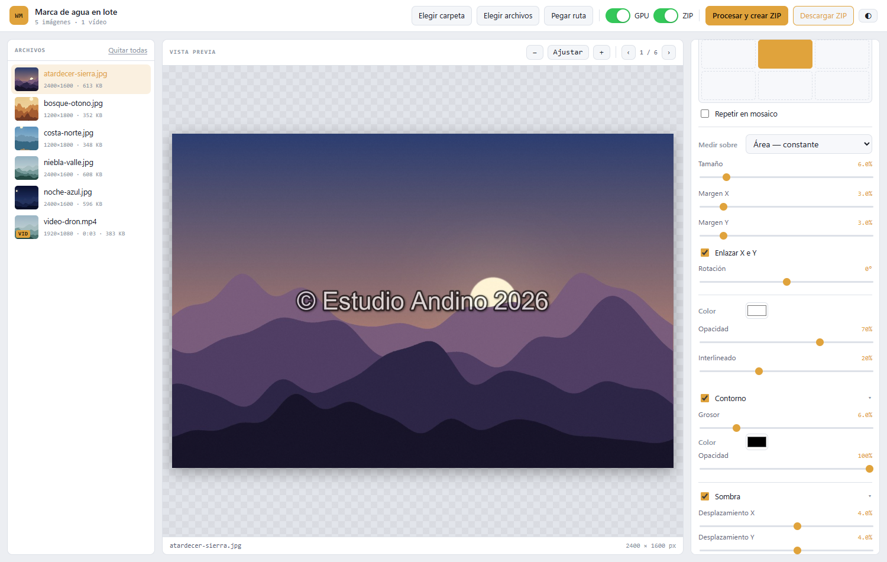

# Marca de agua en lote

App de escritorio (PyWebView + Flask + Pillow) para poner marca de agua a muchas
imágenes y vídeos de una vez y exportarlos en un ZIP sin compresión o como
archivos sueltos.



## Funciones

- **Imágenes y vídeos en el mismo lote**, con vista previa real de cada archivo.
- **Marca de texto o firma en imagen**, con icono opcional junto al texto.
- **Posición en 9 puntos o mosaico**, con rotación, opacidad, contorno y sombra.
- **Tamaño uniforme** entre fotos de distintos formatos y resoluciones.
- **Calidad cuidada**: conserva el perfil de color y el EXIF, y el vídeo replica
  el formato de origen.
- **Aceleración por GPU** para vídeo y **presets** para reutilizar la configuración.
- **Tema claro y oscuro**.

## Capturas

| Mosaico girado en tema oscuro | Vídeo con sus opciones de calidad |
|---|---|
|  |  |

| Imagen vertical ajustada al marco | Lote procesado, con el ZIP listo para descargar |
|---|---|
|  |  |

*Las imágenes de las capturas son paisajes generados por ordenador.*

## Vídeo

La app también pone marca de agua a vídeos (.mp4, .mov, .mkv, .avi, .webm y
otros). Para eso necesita **FFmpeg**, que no viene con Python:

```
winget install Gyan.FFmpeg     # Windows
brew install ffmpeg            # macOS
sudo apt install ffmpeg        # Linux
```

También puedes descargarlo de ffmpeg.org y dejar `ffmpeg` y `ffprobe` en una
carpeta `bin/` junto a `app.py`. Si falta, la app avisa y sigue funcionando con
imágenes con normalidad.

Cómo funciona: la marca se genera **una sola vez** como PNG transparente del
tamaño del vídeo, y FFmpeg la superpone en cada fotograma. Por eso es rápido —
no se decodifica ni se vuelve a dibujar cuadro por cuadro desde Python.

- Los ajustes son los mismos que para imágenes: posición, tamaño, opacidad,
  sombra, contorno, rotación, mosaico, icono y firma.
- La vista previa muestra un fotograma real del vídeo con la marca aplicada.
- Los vídeos girados de móvil se detectan por sus metadatos y la marca se coloca
  sobre la orientación correcta, no sobre la del archivo.
- El audio se copia sin recodificar. Si el códec no cabe en el contenedor de
  salida, se reconvierte a AAC automáticamente.
- Cancelar detiene FFmpeg de inmediato, no al terminar el archivo en curso.

### Formato de salida

Por defecto la salida **replica el vídeo de entrada**: mismo códec, mismo
contenedor, mismo bitrate, mismo formato de color y mismos fps. Un `.mov` con
H.265 sale como `.mov` con H.265; un `.webm` con VP9 sale como `.webm` con VP9.
Solo cambian los píxeles donde va la marca.

Cada codificador recibe los parámetros de bitrate que admite: no son
intercambiables. SVT-AV1 rechaza `-maxrate` fuera del modo CRF, VideoToolbox no
entiende `-crf`, y los preajustes de x264 («medium») no valen para SVT-AV1, que
usa números. Pasarle los de otro rompe la codificación antes de escribir un solo
fotograma.

Si un intento falla, la app prueba automáticamente en cascada: calidad fija en
vez de bitrate, audio recodificado a AAC, formato de color estándar, CPU en vez
de GPU y por último H.264. Te avisa de cuál funcionó, así que nunca pierdes el
archivo en silencio.

En «Calidad» puedes cambiar a *Fija (CRF)* si prefieres controlar el tamaño en
lugar de replicar el bitrate: 0 es sin pérdida pero enorme, 18 es visualmente
idéntico, 23 es lo habitual.

### Aceleración por GPU

Si el equipo tiene una GPU capaz de codificar vídeo, aparece un interruptor
**GPU** en la barra superior. Soporta NVIDIA (NVENC), Intel Quick Sync, Apple
VideoToolbox, AMD AMF y VAAPI.

La detección no se fía de lo que FFmpeg declara: hace una codificación de prueba
real, porque FFmpeg lista `h264_nvenc` aunque no haya tarjeta NVIDIA y solo falla
al intentar usarlo. Si el interruptor no aparece, es que no hay hardware útil.

Si la GPU falla a mitad de un archivo, se reintenta automáticamente por CPU y se
te avisa. Nunca pierdes el resultado.

Imágenes y vídeos pueden ir en el mismo lote y salen juntos en el mismo ZIP.

## Instalación

```bash
git clone https://github.com/gabom88/watermark-app.git
cd watermark-app
pip install -r requirements.txt
python app.py
```

En Linux además hace falta el motor web del sistema:
`sudo apt install python3-gi gir1.2-webkit2-4.1` (o `pip install pywebview[qt]`).

Para probarlo en el navegador en lugar de la ventana nativa:

```bash
python app.py --browser     # http://127.0.0.1:5000
```

En modo navegador no hay diálogo de carpeta (el navegador no da rutas del disco):
ahí se arrastran los archivos o se usa «Elegir archivos», que los sube a una
carpeta temporal.

## Cómo funciona el tamaño

El desplegable «Medir sobre» decide la referencia:

- **Área — constante** (por defecto): usa la raíz cuadrada de ancho × alto. Es la
  única medida que no se altera cuando cambia la relación de aspecto, así que una
  foto apaisada 16:9 y una vertical 9:16 con los mismos píxeles reciben una marca
  del mismo peso visual. Medido en pruebas, varía apenas 1.08× entre formatos muy
  distintos, frente a 1.35× del lado menor y 1.8× del ancho.
- **Lado menor / Ancho / Alto / Diagonal**: por si prefieres anclar la marca a una
  dimensión concreta.
- **Píxeles fijos**: la marca mide siempre los mismos píxeles, sin importar el
  tamaño de la imagen. Útil si todas tus fotos ya salen a una resolución igual.

El margen, el grosor del contorno y la sombra se miden sobre el tamaño de fuente
ya calculado, así que acompañan al texto automáticamente.

## Vista previa

- Rueda del ratón con **Ctrl** para acercar y alejar, o los botones `−` / `+`.
- **Ajustar** encuadra la imagen completa; al pulsarlo de nuevo vuelve al 100 %.
- El porcentaje mostrado es real respecto a la imagen original, no a la copia
  reducida que usa la vista previa.

## Presets

Guarda toda la configuración con un nombre y recupérala después. Se almacenan en
`presets.json`, junto a `app.py`, así que sobreviven al cierre del programa y
puedes copiar ese archivo a otro equipo.

El preset incluye el texto, la fuente, la posición, los márgenes, el color, la
sombra, el contorno y las rutas del icono y de la firma. Si abres un preset en un
equipo donde esa fuente no está instalada, te avisa y conserva la actual.

## Icono y firma

**Icono junto al texto**: carga un PNG y aparece pegado al texto, a la izquierda o
a la derecha. Se escala automáticamente a la altura exacta del texto, así que
parece un carácter más. La separación es ajustable.

**Firma**: en «Tipo de marca» elige *Firma* y la marca pasa a ser una imagen en
lugar de texto. Se dimensiona con los mismos controles de porcentaje o píxeles, y
también recibe sombra y rotación. Usa un PNG con transparencia.

## Calidad de exportación

Medido sobre ruido aleatorio, que es el peor caso posible:

| Formato | Pérdida |
|---|---|
| PNG | ninguna |
| WebP sin pérdida | ninguna |
| JPEG calidad 100 | 50 dB (imperceptible) |
| JPEG calidad 95 | 36 dB (por defecto) |

Si el original es PNG y dejas «Conservar original», la salida es PNG y no pierde
nada. Para JPEG hay recodificación inevitable, pero se usa submuestreo 4:4:4, que
no descarta información de color como el 4:2:0 habitual de las cámaras.

El perfil de color ICC y los metadatos EXIF se conservan. Sin el ICC, una foto en
AdobeRGB o Display P3 se reinterpretaría como sRGB y los colores se verían
apagados.

## Atajos

- `←` / `→` — archivo anterior / siguiente
- `Supr` — quitar el archivo seleccionado
- `Ctrl` + rueda — zoom en la vista previa

## Fuentes

Se leen las fuentes instaladas del sistema. Puedes añadir una suelta con el
botón `+` (solo en la ventana de escritorio) o dejando el archivo `.ttf` en una
carpeta `fonts/` junto a `app.py`.

## Entrega: ZIP o archivos sueltos

El interruptor **ZIP** de la barra superior decide cómo salen los resultados:

- **ZIP** (por defecto): todo en un solo archivo sin comprimir. Cómodo para
  mover un lote entero de una vez.
- **Sueltos**: los archivos por separado. En la ventana de escritorio se abre un
  diálogo para elegir la carpeta destino y se copian ahí directamente, sin pasar
  por un ZIP. En el navegador se descargan uno a uno, con una pausa entre ellos
  para que no se bloquee la tanda.

El modo sueltos es preferible con lotes de vídeo grandes: te ahorra empaquetar y
volver a extraer varios gigabytes.

## Nombre del ZIP

`2026-08-26 01-23-21 export watermark.zip`

Se usan guiones en la hora en vez de `:` porque Windows no permite dos puntos en
nombres de archivo.
